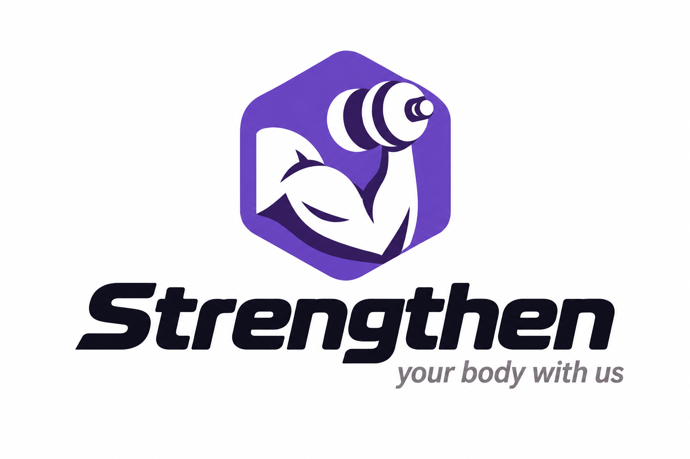

# Strengthen

## Tu entrenamiento, en tus manos
 
Una app que reinventa la experiencia de ir al gimnasio, y centraliza tu experiencia deportiva: Mapa interactivo del gimnasio con la disponibilidad de cada máquina, tracker de calorías y macros, gestor de rutinas, entrenador personal con IA integrada, y un avatar personalizado que evoluciona junto a ti.
 

---
 
> Las tecnologías, arquitectura, proceso de instalación y la licencia aún están por definir. Este documento describe la visión y el alcance del producto.
 
## Sobre el proyecto
 
**Strengthen** es una aplicación pensada para una cadena de gimnasios que busca digitalizar y centralizar todo lo que un usuario necesita durante su entrenamiento.
 
Ir al gimnasio a menudo implica pequeñas fricciones: no saber dónde está una máquina, esperar sin saber cuánto le queda a otra persona, improvisar la rutina del día o llevar el control de la dieta en otra app. Strengthen reúne todo eso en un único lugar, con un diseño moderno y un toque de gamificación que hace que entrenar sea también un juego.

**¿Para quién es?**
* Socios del gimnasio, desde principiantes que necesitan orientación hasta usuarios avanzados que quieren medir su progreso.
* La cadena de gimnasios, que obtiene datos de aforo y uso de las máquinas para mejorar el servicio.
 
## Características principales
| Funcionalidad | Descripción |
|---|---|
| **Mapa interactivo** | Plano de cada centro para localizar las máquinas de un vistazo. |
| **Disponibilidad en tiempo real** | Consulta qué máquinas están libres u ocupadas y el aforo del gimnasio. |
| **Escaneo QR** | Escanea el código de la máquina para registrar el ejercicio y marcarla como ocupada. |
| **Entrenador con IA** | Rutinas recomendadas según tus objetivos. |
| **Seguimiento de entrenamientos** | Historial de ejercicios, rutinas, medidas y progreso. |
| **Seguimiento nutricional** | Registro manual de comidas o cálculo de calorías y macros a partir de una foto. |
| **Avatar personalizable** | Refleja los músculos que trabajas y se personaliza con cosméticos que se compran con tokens ganados entrenando. |
| **Diseño responsive y temas** | Interfaz moderna, adaptable y con temas personalizables. |

---
 

Hecho por Marcos Villagómez y Artem Zimin.
 

